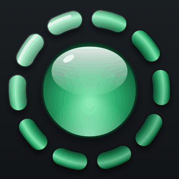

<p align="center">
  
</p>

<h1 align="center">Glass Orb</h1>

A skeuomorphic spinning orb for Android: a green glass orb inside a slowly turning ring of glass
segments. It's a nod to the spinning orb on [LocalSend](https://localsend.org)'s receive screen, made
for [LocalSend Legacy](https://github.com/mdukasa/localsend-legacy).

This repo keeps the **original** version from LocalSend Legacy 0.2.1, as a small demo app you can
install and play with. Tap the orb to switch between spinning and dimmed.

## How it's drawn

Everything is plain `android.graphics` on a `View`, with no OpenGL and no libraries. It runs on
Android 2.3 and up.

- **Pre-rendered once:** when the view gets its size, the orb, the ring, the ring's blurred shadow
  and a lighting overlay are drawn into bitmaps.
  - The glass orb uses radial gradients, a curved gloss and a specular glint.
  - The ring segments are shaded like glass tubes with a radial gradient that looks the same at
    every angle, so they can rotate without the shading turning with them.
- **Every frame (25 fps):** the ring bitmap is rotated, then relit with the fixed top-left light
  (`SRC_ATOP`, so only the segments catch it), and the shadow is slipped underneath (`DST_OVER`)
  so it always falls straight down. The result is the light staying put while the glass turns
  through it.

The whole thing is [`OrbView.java`](app/src/main/java/io/github/mdukasa/glassorb/OrbView.java).

## Performance note

Compositing every frame live looks lovely but isn't cheap. On a 600 MHz ARMv6 HTC Wildfire S it uses
over half the CPU. LocalSend Legacy 0.2.2 and later pre-render one 36° cycle of the ring (it has 10
identical segments) into frames instead, which brings that down to about 11%. Use this original on
anything from the last decade; for very old phones, see LocalSend Legacy's
[pre-rendered `OrbView`](https://github.com/mdukasa/localsend-legacy/blob/main/app/src/main/java/io/lslegacy/OrbView.java).

## Build

Requires JDK 17 and the Android SDK (platform 34, build-tools 34).

```
./gradlew assembleRelease
```

Or download the APK from [Releases](https://github.com/mdukasa/glass-orb-demo/releases/latest).

## License

Apache-2.0
